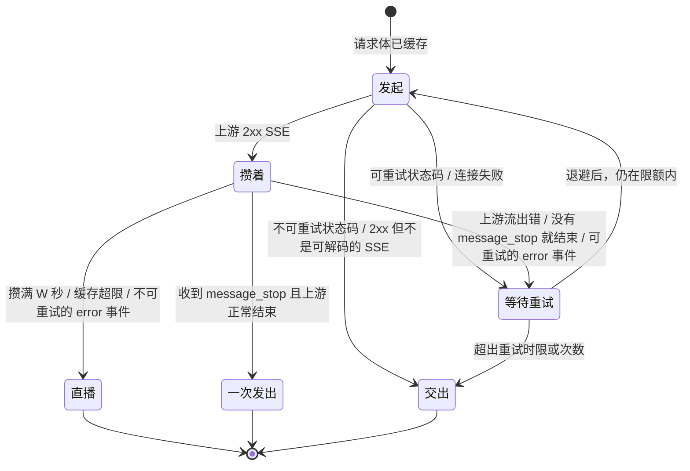

# Design: Anthropic Messages 流式回复先攒后发 + 重试

## 目标

在不改变现有心跳窗口、透传与迟到改写语义的前提下，让 Anthropic Messages 的流式回复在客户端看到任何事件之前可以重试：上游回复收全才发，没收全前上游断了就重发同一个请求。

## 配置（`src/config.rs`）

| 参数 | 环境变量 | 默认值 | 含义 |
|---|---|---|---|
| `--hold-window` | `KEEP_SSE_HOLD_WINDOW` | `0` | 每次尝试从上游第一个字节起最多攒多少秒；0 关闭整个功能 |
| `--retry-deadline` | `KEEP_SSE_RETRY_DEADLINE` | `180` | 状态码或请求失败后，请求到达（或上一次流断）多少秒内还能发起新的一次 |
| `--max-stream-retries` | `KEEP_SSE_MAX_STREAM_RETRIES` | `3` | 流到一半断后最多重试几次 |
| `--hold-max-bytes` | `KEEP_SSE_HOLD_MAX_BYTES` | `8388608` | 攒着的回复超过这么多字节就提交 |
| `--hold-max-body` | `KEEP_SSE_HOLD_MAX_BODY` | `16777216` | 请求体超过这么多字节就不攒、不重试 |

`ResolvedConfig` 里时长存为 `Duration`。

## 入口（`src/lib.rs`、`src/sse.rs`）

- `lib::handle` 在识别出候选端点时记下请求到达时刻 `arrived`，传给 `sse::handle_stream`。重试时限从这里算，日志的 `body_read_ms` 是读请求体的耗时。
- `handle_stream` 开头分派：`kind == AnthropicMessages`、`hold_window > 0`、请求体不超过 `hold_max_body` 时走 `hold::handle`；请求体超限时写一行 info 后走原路径；其余一律走原路径。

## 先攒后发（`src/hold.rs`）

`hold::handle` 把请求留成模板（方法、改写后的 URI、过滤后的头、请求体 `Bytes`），起一个后台任务驱动整个过程，自己等这个任务通过 oneshot 交回响应。后台任务分两部分：

### 一次尝试：`attempt`

发出请求并读到能下结论为止，返回：

- `Complete`：收到 `message_stop` 且 body 正常结束，带响应头和全部事件字节；
- `Commit`：不再攒（攒满 W、缓存超过 `hold_max_bytes`、不可重试的 error 事件），带响应头、已攒的字节和剩下的解码流；
- `Deliver`：照现在的方式交出的响应（不可重试的状态码；2xx 但不是 SSE 或编码不可解）；
- `Status`：可重试的状态码（500、502、503、504、529）；
- `Request`：上游请求失败（连不上，或回响应头之前连接就断了）；
- `Stream`：流到一半断（读出错、没有 `message_stop` 就结束、可重试的 error 事件）。

W 从本次第一个字节起算，用一个只在收到第一个字节后才启用的计时器与读流赛跑。

`EventScanner` 跟踪解码后的事件流：按 `\r`、`\n`、`\r\n` 切行，记下当前事件的 `event:` 和 `data:`，在空行处判定。只关心两类事件：`message_stop`，以及 `error`（取 data JSON 里的 `error.type`，解析不了视为未知类型、按可重试处理）。单行和单个事件的 data 最多留 64 KiB。

### 下行：`Downstream`

两种状态：

- `Pending`：还没回响应头，持有交回响应的 oneshot。计时器是心跳窗口截止时刻（`handle_stream` 起算一个间隔）。到期则先回网关自己的 200 SSE，转入 `Open`，首个心跳立即到期，与现有窗口超时路径相同。
- `Open`：网关已回 200，持有 `SseWriter`。计时器每个间隔写一个心跳。攒着期间什么都没写，心跳都落在事件边界上。

`keep_alive` 推进计时器，只在客户端断开时完成：`Pending` 时等 oneshot 的接收端被丢弃（hyper 在客户端断开时丢弃服务 future），`Open` 时等下行通道的接收端被丢弃（`SseWriter::closed`）。驱动循环把它与尝试、退避赛跑，所以客户端一断开，当前的上游请求和退避计时器都随之丢弃。

结论的交付：

| 结论 | `Pending`（窗口内） | `Open`（窗口后） |
|---|---|---|
| `Complete` | 透传上游状态码和响应头（去 hop-by-hop、`Content-Length`、`Content-Encoding`），写出全部事件 | 写出全部事件 |
| `Commit` | 同上，写出已攒的部分后按现有方式桥接剩下的流 | 写出已攒的部分后桥接剩下的流 |
| `Deliver` | `proxy::passthrough_response` | 与现有 `bridge` 相同：2xx 走 `handle_success`，非 2xx 读错误体后 `build_late` |
| 连接失败用完 | 502（`proxy::bad_gateway`） | `build_late`（请求失败） |
| 流断用完 | 502，Anthropic 错误 JSON（`api_error`，"upstream stream interrupted"） | `build_late`（请求失败，按迟到规则改写） |

### 重试

- 退避按已重试次数取 1、2、4、8 s，之后每次 8 s；状态码失败与流断共用这个序列。
- 状态码、请求失败：`now + 退避 <= 时限` 才重试，否则交出这次的结果。时限起初是 `arrived + retry_deadline`，每次重试流断时改为 `断开时刻 + retry_deadline`。时长大到加不上去时视为没有时限；`hold_window` 同理，视为不按时间提交。
- 流断：`stream_retries < max_stream_retries` 才重试，不看时限。
- 要重试时丢弃这次的响应（hyper client 关闭该连接）和已攒的字节。

### 日志

- 每次重试一行 warn：`attempt`、`reason`、`backoff_ms`、`stream_retries`。
- 每个走这条路径的请求结束时一行 info：`outcome`（`complete` / `committed` / `error` / `cancelled`）、`attempts`、`stream_retries`、`hold_ms`（最后一次从第一个字节到写给客户端）、`total_ms`（从请求到达起）、`body_read_ms`、`failures`（每次失败的原因）。
- 原因只写状态码、错误类型和传输错误的描述（连同 source 链：hyper 的错误自身只说类别），不写请求体、响应体和头。

`outcome`：`complete` 是收全后一次发出（发出途中客户端断开记为 `cancelled`）；`committed` 是转为直播（含 2xx 但不攒的响应）；`error` 是最后交给客户端的是错误（不可重试的状态码或 error 事件、重试用完）；`cancelled` 是客户端在结论之前断开。

## 对现有代码的改动（`src/sse.rs`、`src/encoding.rs`）

只做提取，不改行为：

- `build_upstream_request` 拆出 `prepare_upstream_parts`，模板和原路径共用。
- 窗口超时时网关自己的 200 SSE 响应拆成 `gateway_sse_response`；透传路径的响应头处理拆成 `passthrough_head`。
- `handle_success` 的读流循环拆成 `bridge_stream`（接受已解码的流和边界跟踪器），提交时接着已攒的部分继续桥接。
- `bridge` 拿到上游结果之后的处理拆成 `deliver_late`。
- `SseWriter` 增加 `closed()`；`encoding` 增加解码流的类型别名 `DecodedStream`。

## 取舍

- 不再逐字显示：回复攒完一次出现，思考阶段客户端只看到心跳。
- 每次重试上游都重新生成一次、重新计费。
- 提交后（W 之后）再断，仍然对客户端可见。
- 内存：请求体留到请求结束，回复缓存最多 `hold_max_bytes`；`hold_max_body` 限定最坏情况。
- 收到 `message_stop` 后上游 body 读出错也算失败并重试：成功只认两个条件同时成立。
